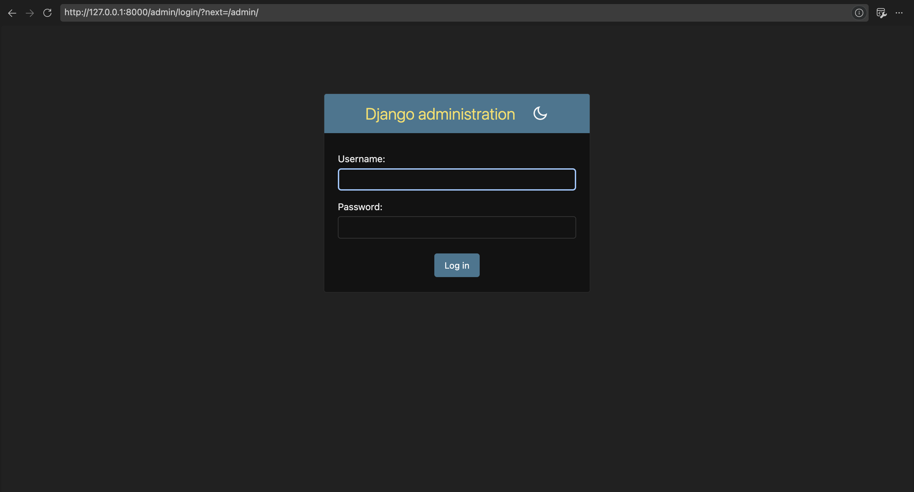
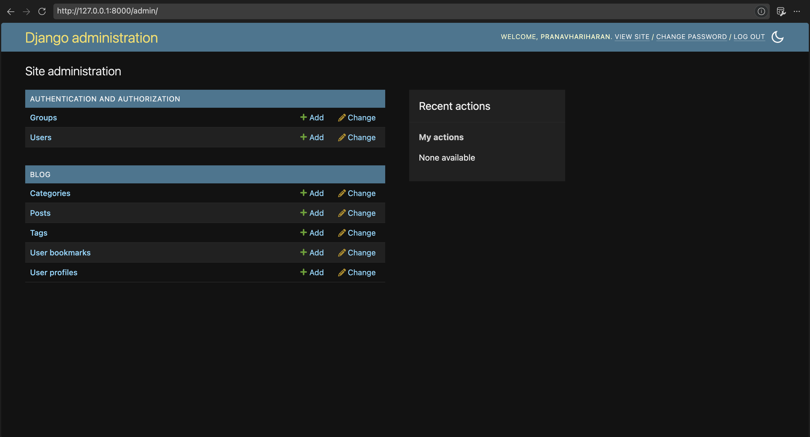
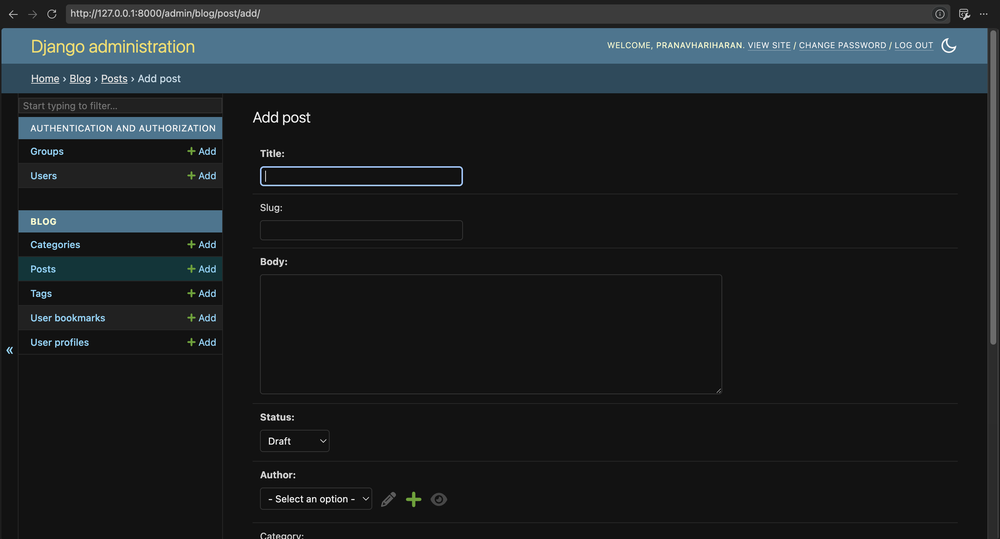

# Django Blog Schema — Relational Modeling & Migrations

A relational blog backend built from scratch in **Django** demonstrating all three core database relationship types—**One-to-One**, **Many-to-One**, and **Many-to-Many** (including a custom `through` table)—alongside database migrations and Django Admin integration.

---

## 🎯 Objectives Achieved

- [x] Bootstrapped a Django project (`core`) and blog application (`blog`) inside an isolated virtual environment.
- [x] Designed and implemented models covering all three relational database paradigms:
  - **One-to-One (`OneToOneField`)**: Extended Django's built-in `User` model with `UserProfile`.
  - **Many-to-One (`ForeignKey`)**: Linked `Post` records to an `Author` (`User`) and a `Category`.
  - **Many-to-Many (`ManyToManyField`)**: Implemented both a standard M2M (`Post` ↔ `Tag`) and an advanced M2M using a custom intermediate model (`UserBookmark`) with extra relational metadata (`saved_at`, `notes`) and a `UniqueConstraint`.
- [x] Generated and applied schema migrations (`makemigrations` & `migrate`).
- [x] Registered all models in the Django Admin interface and verified CRUD operations.

---

## 🗂️ Database Schema Overview

| Model | Relationship Type | Target Model | Description |
| :--- | :--- | :--- | :--- |
| **`UserProfile`** | `OneToOneField` | `auth.User` | Stores extended profile metadata (`bio`, `website`) 1:1 per user. |
| **`Category`** | — | — | Organizes blog posts into distinct topics with auto-generated slugs. |
| **`Tag`** | — | — | Keyword labels assigned across multiple blog posts. |
| **`Post`** | `ForeignKey` (×2)<br>`ManyToManyField` (×2) | `auth.User`<br>`Category`<br>`Tag`<br>`auth.User` (via `UserBookmark`) | Core blog entry model featuring `TextChoices` status (`Draft`/`Published`), auto-slugification, and relational links. |
| **`UserBookmark`** | Custom `through` Model | `auth.User` ↔ `Post` | Intermediate join table tracking bookmarked posts with `saved_at` timestamps, `notes`, and unique `(user, post)` constraints. |

---

## 📁 Project Structure

```text
django_blog_project/
├── core/                   # Project configuration
│   ├── settings.py         # App registration & database config
│   ├── urls.py
│   └── wsgi.py
├── blog/                   # Blog application
│   ├── migrations/         # Auto-generated schema migrations
│   │   └── 0001_initial.py
│   ├── admin.py            # Admin panel model registrations
│   ├── models.py           # Relational database models
│   └── apps.py
├── screenshots/            # Verification screenshots
├── db.sqlite3              # Migrated SQLite database
├── manage.py
└── README.md

## 📸  Screenshots

### 1. Django Admin Authentication


### 2. Registered Blog Models in Site Administration


### 3. Post Creation Form & Relational Widgets
